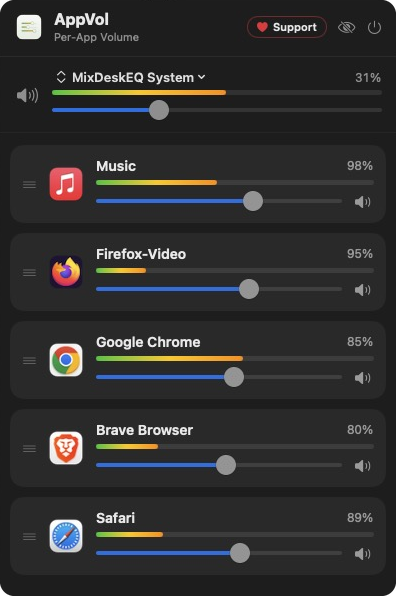

# AppVol

**Every macOS app its own volume, right in your menu bar. Free, no audio driver.**

## Download

**[⬇ Latest release](../../releases/latest)** · [adelvo.io/appvol](https://adelvo.io/appvol/)

Signed & notarized. Requires macOS 14.2 or later, Apple Silicon or Intel. New versions install in-app.

## What it does

- **Per-app volume & mute:** a slider and mute for every app that's playing.
- **Real VU meters:** actual level metering per app and master.
- **No audio driver:** uses Apple's Core Audio process taps. Nothing to install into your system.
- **Output device switch:** pick speakers, AirPods or an interface right from the panel. AppVol follows when macOS switches by itself.
- **Hide what you don't need:** right-click to hide an app, a toggle brings it back.
- **Drag to reorder:** arrange apps in the order you like.
- **Remembers your settings:** a level reapplies automatically the next time the app plays.

## Part of the free Adelvo audio toolkit

- [MixDesk X](https://github.com/adelvo-software/MixDeskX): software mixing desk and audio router
- [Volume Balance](https://adelvo.io/volume-balance/): browser extension that evens out loudness

Found a bug? Please open an [issue](../../issues).
